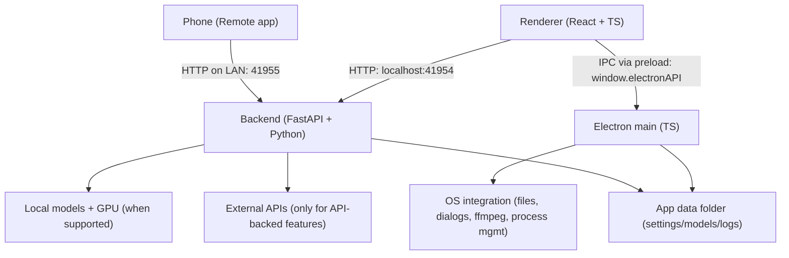

# Development

LTX Desktop has three layers:

- **Renderer (`frontend/`)**: TypeScript + React UI. It calls the local backend over HTTP at `http://localhost:41954` and talks to Electron through the preload bridge (`window.electronAPI`).
- **Electron (`electron/`)**: TypeScript main process and preload. It owns the app lifecycle and OS integration (file dialogs, native export through ffmpeg, starting and managing the Python backend). The renderer is sandboxed (`contextIsolation: true`, `nodeIntegration: false`).
- **Backend (`backend/`)**: Python + FastAPI local server. It orchestrates generation, model downloads, and GPU execution. It also serves the separate, authenticated [Remote](../README.md#remote) API on port `41955`. It calls external APIs only when API-backed features are used.



## Quickstart

Prerequisites: Node.js, `pnpm`, `uv`, Python 3.12+, and Git.

```bash
pnpm setup:dev   # one-time setup
pnpm dev         # run the app
```

| Command | What it does |
| --- | --- |
| `pnpm dev:debug` | Run with the Electron inspector and the Python backend under `debugpy`. |
| `pnpm typecheck` | Run the TypeScript and Python (pyright) type checks. |
| `pnpm lint` | Lint the frontend. |
| `pnpm backend:test` | Run the Python backend tests (pytest). |
| `pnpm scripts:test` | Run the frontend, Electron, and shared `node:test` files. |
| `pnpm build:frontend` | Build the frontend. |
| `pnpm openapi:generate` | Regenerate the OpenAPI schema and TypeScript types after a backend API model change. |
| `pnpm perf:dev` | Start the backend headless and open the performance runner dashboard. See [`backend/performance_runner/README.md`](../backend/performance_runner/README.md). |

Pull requests must pass `pnpm typecheck`, `pnpm backend:test`, and the frontend build. To build installers, see [`INSTALLER.md`](INSTALLER.md).

## Related docs

- [`CONTRIBUTING.md`](CONTRIBUTING.md): how to contribute
- [`backend/architecture.md`](../backend/architecture.md): backend architecture
- [`remote-lan.md`](remote-lan.md): LAN Remote architecture
- [`local-compat-matrix.md`](local-compat-matrix.md): tool and hardware compatibility
- [`INSTALLER.md`](INSTALLER.md): building installers
- [`TELEMETRY.md`](TELEMETRY.md): telemetry and privacy
