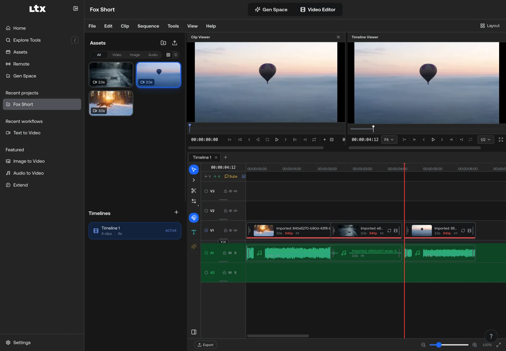

# Gen Space and Video Editor

Gen Space and the Video Editor are the original interfaces of LTX Desktop. They remain available for existing projects. Open them from **Gen Space** in the sidebar. For new work, see the [tools on the Home screen](tools-and-options.md).

- **Gen Space:** a project gallery with prompt-driven image generation and editing, video generation, Retake, and IC-LoRA. It can generate locally or through the LTX and fal APIs.
- **Video Editor:** a timeline editor with ffmpeg export, AI gap fill, and customizable keyboard shortcuts.

  

Options for both are in **Settings > Legacy**. See [Settings](setup-and-settings.md#settings).

Related:

- [LoRA selector in Gen Space](models-and-loras.md#lora-selector-in-gen-space)
- [fal and LTX API keys](api-keys-and-privacy.md)
