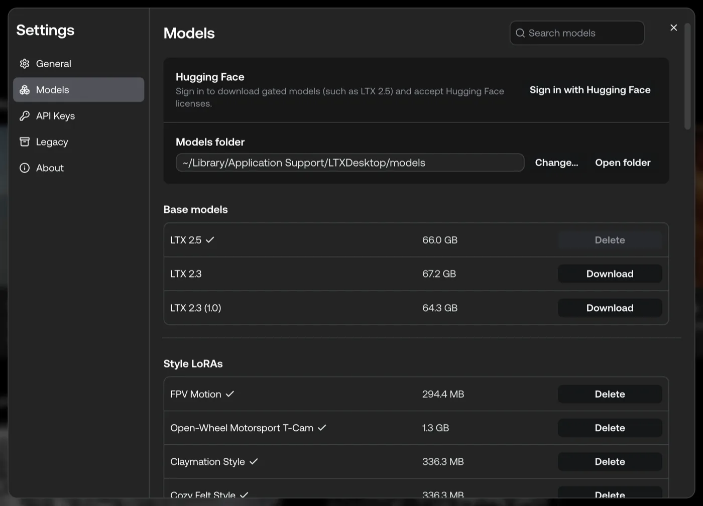

# Models and LoRAs

## Models

### Local models

| Model | Where | Notes |
| --- | --- | --- |
| **LTX 2.5 Fast** | Local (default) | Distilled 22B model. Runs every tool: Text, Image, and Audio to Video, Retake, Extend, IC-LoRAs, and LoRAs. Uses audio-visual prompts |
| **LTX 2.3 Fast** | Local | Previous generation. Runs the same tools. Pick it in a tool's **Model** menu |
| **LTX 2.5 Pro** / **2.3 Pro** | API only | Paid cloud generation in Gen Space and the Video Editor |

A tool's **Model** menu lists the models that you downloaded.

### Managing models

**Settings > Models** manages every model on your machine. The tab has these sections:

- **Hugging Face:** sign in to download gated models.
- **Models folder:** see, change, or open the folder where models are stored.
- **Base models:** download and delete the LTX checkpoints for local generation (**LTX 2.5**, **LTX 2.3**, and **LTX 2.3 (1.0)**). The tool **Model** menu names the matching generation models **LTX 2.5 Fast** and **LTX 2.3 Fast**.
- **Style LoRAs** and **IC-LoRAs:** download and delete the adapters used by the LoRA and IC-LoRA tools.
- **Encoding models:** download the local text encoder and the local prompt enhancer.
- **Image models:** download the local text-to-image model used by Gen Space.

<p align="center">
  
</p>

Use the search field to find a model. Downloads are stored in the `models/` folder (see [First run & data locations](setup-and-settings.md#first-run--data-locations)). A tool also downloads its LoRA the first time you generate with it.

### Gated models

Some models, including the LTX 2.5 weights and some LoRAs, are **gated** on Hugging Face. A gated model has files that the publisher shares only with users who agreed to its license or disclaimer. The app cannot download it until you do these steps:

1. Sign in with Hugging Face. Use **Sign in with Hugging Face** on the first-run Setup screen, in **Settings > Models**, or on the model itself. A browser window opens for the sign-in.
2. Read and accept the license or disclaimer on the model's Hugging Face page. Use **Request access** or the link in the app. The LTX-2 model license is also in **Settings > About**.
3. Return to the app and start the download again.

Some publishers approve access by hand, so access can take time. Your Hugging Face sign-in is only used to download model files. Community models can also carry their own terms. Read them before you accept.

### LoRA/IC-LoRA Library

LoRAs steer **local** video generation toward a specific style, motion, or effect. They run on local hardware only (Windows/Linux NVIDIA GPUs or Apple Silicon Macs).

- **LoRAs** apply a style or camera motion to text-to-video and image-to-video. Examples: Cozy Felt, Claymation, Fantasy Painterly, Paper Cut-Out, Cinemagraph, Jib Up, Jib Down, Dolly In, Dolly Out, Drone Flythrough, OpenWheel T-Cam, Transition, VBVR.
- **IC-LoRAs** (in-context LoRAs) transform a source video. Examples: Day to Night, Layout to Render, Restore, Deblur, Colorization, Clean Plate, Decompression, Water Simulation.

Each LoRA is a tool of its own in the feature gallery and in quick search. Choose it, and the app downloads it the first time you generate. Each LoRA runs on the checkpoint it was trained for. Entries authored by **LTX** are official. Community entries show a disclaimer that LTX does not endorse them or take responsibility for them. Every entry links to its Hugging Face page, and some are gated.

### Custom LoRAs

You can use your own `.safetensors` LoRA files instead of (or alongside) the catalog.

**Which LoRAs are supported.** Local generation uses **LTX 2.5 Fast** or **LTX 2.3 Fast** (both 22B distilled). Catalog entries list the models they support (typically both). LoRAs labeled **LTX-2**, **LTX-2.3**, or **LTX-2.5** target this family and are supported. This includes LoRAs exported from ComfyUI for LTX-Video (their key names are remapped automatically). A LoRA whose tensors do not match the active model is skipped, so it has no effect rather than producing an error. LoRAs built for other base models (for example SDXL, Wan, Hunyuan, or older LTXV 0.9.x) target a different architecture and do not take effect.

**Where to put the files.** Catalog LoRAs land in their own subfolder under `loras/` (one per LoRA). Catalog IC-LoRAs land under `ic-loras/`. Drop your own `.safetensors` files straight into the `loras/` (or `lora/`) subfolder of your models folder:

```
models/
└── loras/
    ├── cinematic.safetensors
    ├── claymation.safetensors
    └── <lora-id>/              ← catalog LoRA, one subfolder per LoRA
        └── <name>.safetensors
```

> **Use the `loras/` subfolder.** A file is detected as a LoRA only if it lives in a folder named `loras`/`lora` **or** its filename contains `lora`. Many LoRAs are not named that way. Dropping them straight into `loras/` is the reliable option. It does not collide with catalog downloads, which each get their own subfolder. Subfolders are scanned recursively, so further nesting is fine.

Your models folder is the location you chose during setup, or the default for your platform. See [Setup and settings](setup-and-settings.md#first-run--data-locations).

### LoRA selector in Gen Space

In the Gen Space view, **Browse LoRAs** opens the LoRA catalog. **Browse IC-LoRAs** (in the IC-LoRA panel) opens the IC-LoRA catalog. A **LoRA** selector also appears next to the other video settings (FPS, aspect ratio) when **all** of these are true:

1. You are in **Video** generation mode (not Image, Retake, or IC-LoRA).
2. You are generating **locally**, not in API/cloud mode.
3. **At least one** LoRA file is detected in the models folder.

Open the selector to tick one or more LoRAs and adjust the strength of each. If you added files while the app was open, reopen the generation view (or restart the app). The installed-LoRA list is read on load.
